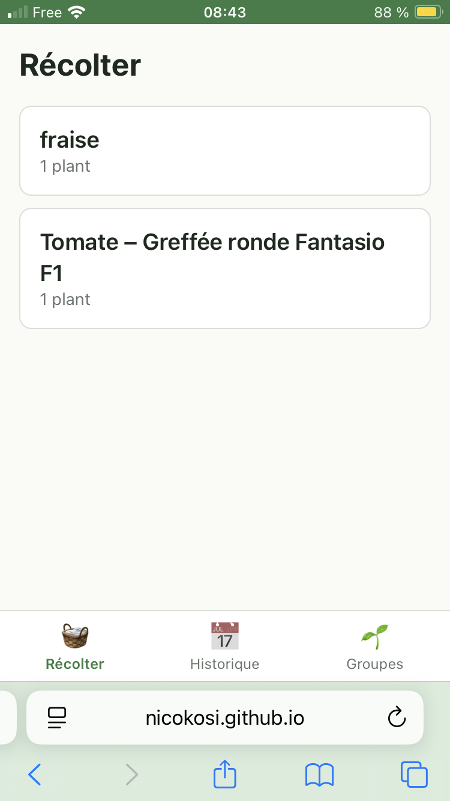
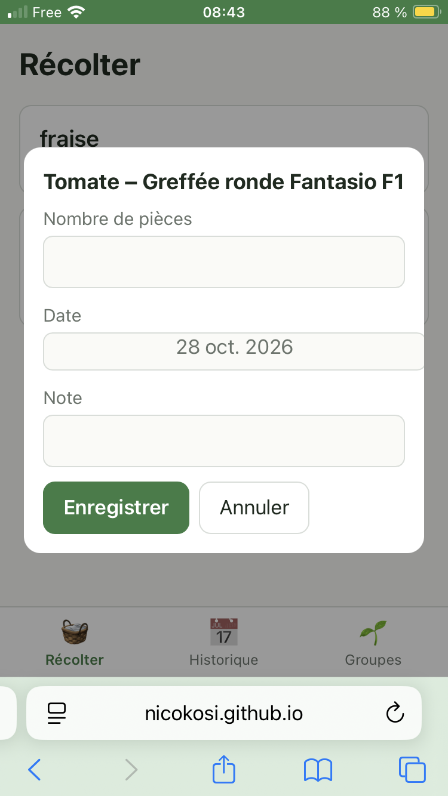
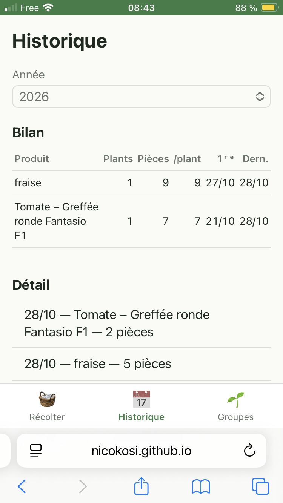
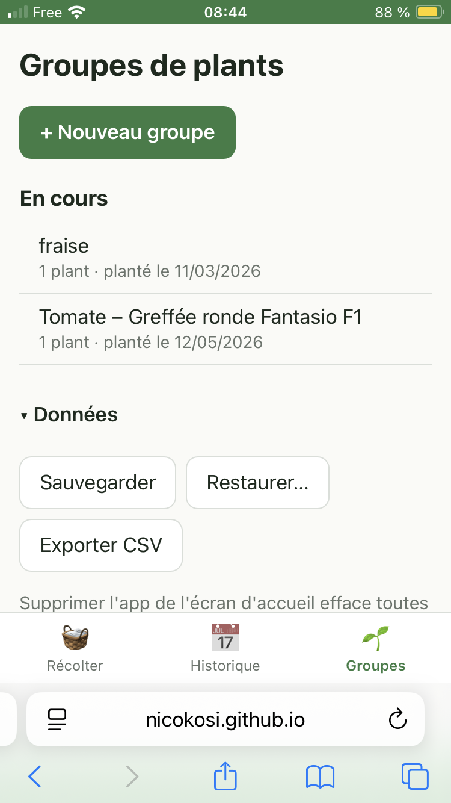

# Ma récolte

Application web installable sur iPhone pour historiser les récoltes du potager :
des **groupes de plants** déclarés à la plantation, des **récoltes** comptées en pièces,
et un **bilan par année**. Fonctionne hors ligne ; les données restent sur l'iPhone.

Application : https://nicokosi.github.io/marecolte/

## Aperçu

| Récolter | Saisie | Historique | Groupes |
|---|---|---|---|
|  |  |  |  |

## Documentation

Choix techniques : [ADR 0001](docs/adr/0001-pwa-vanilla-github-pages.md).
Spécification : [docs/specs](docs/specs/2026-10-27-marecolte-design.md).

## Développer

Aucune dépendance, aucun build. Il faut seulement Node (≥ 20) pour les tests et Python pour servir les fichiers.

```sh
node --test tests/            # tests de la logique métier (domain.js)
python3 -m http.server 8000   # puis http://localhost:8000/
```

| Fichier | Rôle |
|---|---|
| `domain.js` | Logique métier pure (validation, bilan, CSV, sauvegarde) |
| `app.js` | Interface, navigation, stockage `localStorage` |
| `index.html`, `style.css` | Structure et styles |
| `sw.js` | Cache hors ligne |
| `manifest.webmanifest`, `icon-*.png` | Installation sur l'écran d'accueil |

## Déployer

1. **Incrémenter `CACHE` dans `sw.js`** (`marecolte-v1` → `marecolte-v2`…). Sans cela, l'iPhone garde l'ancienne version.
2. `git push`.

Première mise en ligne : sur GitHub, *Settings › Pages › Build and deployment › Deploy from a branch*, puis `main` et `/ (root)`.
L'app est alors servie à `https://<compte>.github.io/marecolte/`.

Après un déploiement, la nouvelle version apparaît sur l'iPhone au deuxième lancement de l'app.

## Installer sur l'iPhone

1. Ouvrir l'URL dans **Safari**.
2. Bouton **Partager** › **Sur l'écran d'accueil**.
3. Lancer l'app depuis l'icône (et non depuis Safari : les données ne sont pas partagées entre les deux).

## ⚠️ Données

- **Supprimer l'icône de l'écran d'accueil efface toutes les données.**
- Sauvegarder régulièrement : onglet *Groupes* › *Données* › **Sauvegarder** (fichier JSON à garder dans Fichiers / iCloud Drive).
- **Restaurer…** remplace toutes les données par celles d'une sauvegarde.
- **Exporter CSV** produit un fichier pour un tableur (non réimportable).
